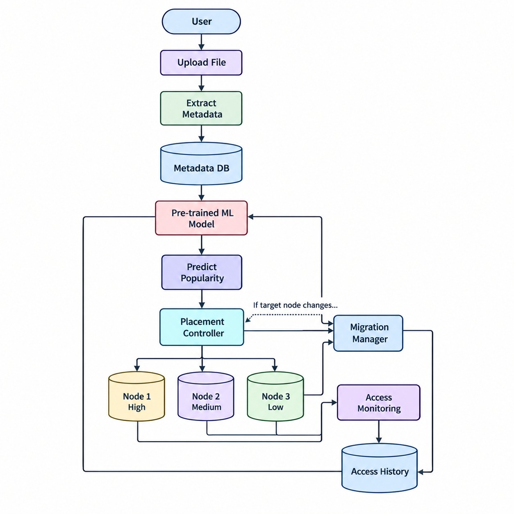

# AI-Driven Dynamic Data Placement in Cloud Distributed File Systems Using Machine Learning

## Project Overview

This project aims to develop an intelligent data placement system for cloud-based distributed file systems using Machine Learning (ML).

The system analyzes file access patterns to predict file popularity and recommends suitable storage nodes. The objective is to improve data access performance, utilize storage resources efficiently, and reduce file retrieval latency.

The initial prototype will simulate distributed storage nodes locally and use file access data to develop and evaluate a machine learning-based placement strategy.

## Objectives

- Simulate a distributed file system with multiple storage nodes.
- Implement file upload, storage, and retrieval.
- Record file access frequency and timestamps.
- Store file metadata and access logs in PostgreSQL.
- Train a machine learning model to predict file popularity.
- Dynamically recommend storage locations based on predicted popularity.
- Develop a web dashboard to monitor files, storage nodes, and placement decisions.
- Evaluate performance using metrics such as access latency and storage utilization.

## Technology Stack

- **Programming Language:** Python
- **Backend Framework:** Flask
- **Database:** PostgreSQL
- **Machine Learning:** Scikit-learn
- **Data Processing:** Pandas
- **Model Persistence:** Joblib
- **Frontend:** HTML, CSS, JavaScript
- **Version Control:** Git and GitHub

## Project Structure

```text
dynamic_data_placement/
├── app.py
├── config.py
├── requirements.txt
├── database/
│   ├── db.py
│   └── schema.sql
├── storage/
│   ├── node1/
│   ├── node2/
│   └── node3/
├── ml/
│   ├── dataset.py
│   ├── train_model.py
│   └── predict.py
├── placement/
│   └── placement_controller.py
├── services/
│   ├── file_service.py
│   └── access_logger.py
├── templates/
│   └── dashboard.html
└── static/
    ├── style.css
    └── script.js
```

## System Architecture

The proposed system consists of the following components:

1. **File Management:** Handles file uploads, storage, and retrieval.
2. **Storage Nodes:** Simulate multiple storage locations.
3. **Access Logger:** Records file access events and timestamps.
4. **Metadata Database:** Maintains file information, node information, and access records.
5. **ML Prediction Module:** Uses historical access patterns to predict file popularity.
6. **Placement Controller:** Recommends storage locations based on predicted popularity and node capacity.
7. **Web Dashboard:** Displays file information, storage utilization, and placement decisions.




## Installation and Setup

### Prerequisites

- Python 3
- Git
- Visual Studio Code (recommended)
- PostgreSQL (for database integration)

### 1. Clone the Repository

```bash
git clone https://github.com/sn-31/dynamic_data_placement.git
cd dynamic_data_placement
```

### 2. Create a Virtual Environment

```bash
python3 -m venv venv
```

Activate it on macOS or Linux:

```bash
source venv/bin/activate
```

### 3. Install Dependencies

```bash
pip install -r requirements.txt
```

### 4. Configure the Database

Install and configure PostgreSQL. Update the database connection settings in `config.py` and create the required tables using `database/schema.sql`.

### 5. Run the Application

Once the Flask application has been implemented:

```bash
python app.py
```

Open the local URL displayed in the terminal in your browser.

## Machine Learning Approach

The system will use historical file-access data to estimate file popularity.

Potential input features include:

- File access frequency
- Time since the last access
- Recent access counts over selected time windows
- File size

The prediction module will generate a popularity estimate or class. The placement controller will use that prediction, together with storage-node capacity and placement rules, to recommend a suitable node.

Initially, synthetic access data can be used to develop the prototype. A suitable public workload dataset can be incorporated later for more realistic evaluation.

## Performance Evaluation

The prototype can be evaluated using the following metrics:

- File retrieval latency
- File access response time
- Storage utilization across nodes
- Distribution of files among nodes
- Popularity prediction performance
- Comparison of static, heuristic, and ML-based placement strategies

Results will be measured during testing rather than assumed in advance.

## Development Phases

- **Phase 1:** Project planning and technology selection.
- **Phase 2:** Core prototype development, storage simulation, access logging, ML integration, and placement logic.
- **Phase 3:** System integration, testing, performance evaluation, and documentation.

## Current Development Status

The project repository and initial directory structure have been created. The application, database, prediction model, placement algorithms, and dashboard will be implemented and tested incrementally.

## Future Enhancements

- Integration with real cloud storage services.
- Evaluation using real-world file-access traces.
- More advanced popularity prediction models.
- Automated file migration between storage tiers.
- Support for additional storage nodes and larger workloads.

## Author

**GitHub:** [sn-31](https://github.com/sn-31)

## License

A license can be added when the project's distribution requirements are decided.
